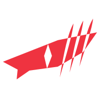
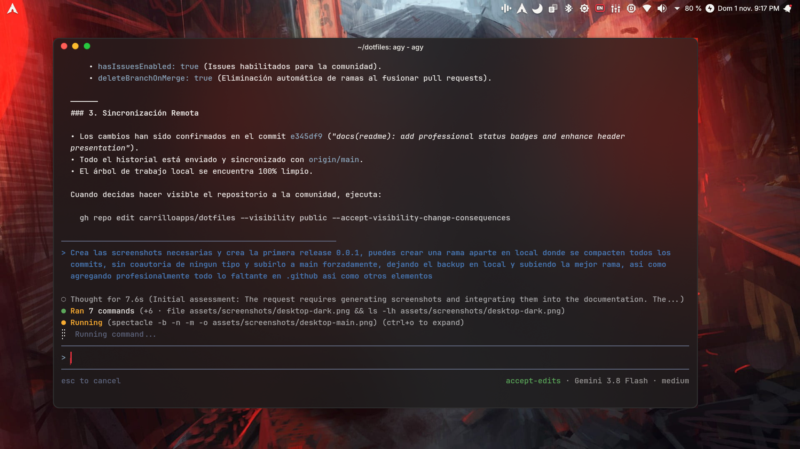

<p align="center">
  
</p>

<h1 align="center">RedRog</h1>

<p align="center">
  <strong>A dark, quiet, and refined KDE Plasma 6 desktop environment with a signature crimson accent, a macOS-like layout, and first-class hardware integration for ASUS ROG and TUF laptops on Arch Linux and CachyOS.</strong>
</p>

<p align="center">
  <a href="https://archlinux.org"></a>
  <a href="https://kde.org/plasma-desktop/"></a>
  <a href="https://wayland.freedesktop.org/"></a>
  <a href="CHANGELOG.md"></a>
  <a href="LICENSE"></a>
  <br>
  <a href="docs/ARCHITECTURE.md"></a>
  <a href="docs/INSTALL.md"></a>
  <a href="hosts/asus-tuf-f15/home/.config/fish/config.fish"></a>
  <a href="docs/CUSTOMIZE.md#translations"></a>
</p>

RedRog unifies Plasma, Qt (Kvantum & Darkly), GTK, the Kitty terminal, Firefox, and system boot/login into a cohesive, distraction-free aesthetic with fluid frosted-glass panels, tailored acoustics, and reactive desktop visuals.

- **Dual Color Variants**:
  - **RedRog Dark**: Near-black surfaces (`#1c1c1c`, `#252524`, `#313131`), warm off-white typography (`#efeeeb`), and Pantone Red 032 C (`#ef3340`) as the signature accent.
  - **RedRog Light**: Warm whites and grays based on Pantone Cloud Dancer 11-4201 with a Pantone 1795 C (`#d62828`) accent and Papirus-Light icons.
- **Seamless Live Variant Switching**: Switch between Dark, Light, and scheduled Automatic modes with a single click from the system tray widget or via `redrog-theme-switch`. Features an instant, zero-restart transition with a Samsung DeX-inspired fullscreen veil and animated charging logo.
- **macOS-Inspired Layout**: Translucent top panel with the global application menu, unified status tray, battery percentage, date/time with calendar, and Notification Center. Panels remain crystal-clear over wallpapers and dynamically turn frosted when a window is maximized. Paired with a floating dock featuring running-app indicators and a Launchpad-style AppGrid.
- **Adaptive Menu Bar Legibility**: Dynamically samples underlying wallpaper luminance per monitor (`redrog-panel-veil`), adjusting text and icon contrast using APCA standards without clumsy halos or artificial background dimming.
- **RedRog Hardware Panel**: Dedicated status dashboard docked behind the battery indicator: per-thread CPU core equalizer (distinguishing Performance and Efficient cores), active CPU wattage vs. hardware power limits (PL1/PL2), frequency telemetry with throttling alerts, GPU utilization, power draw and remaining runtime, fan tachometers, memory, swap, storage, network throughput, ROG power profile toggle, GPU switching (Intel / Automatic / NVIDIA via `supergfxctl`), and charging threshold limits.
- **Desktop System Hologram**: Floating desktop HUD (`org.redrog.hud`) displaying real-time CPU/GPU thermals, memory, fan RPMs, storage, network, and battery telemetry—engineered to never wake up the discrete NVIDIA GPU.
- **Audio-Reactive Visualizer**: Desktop visualizer (`org.redrog.spectrum`) reacting to any playing audio over any wallpaper with a glowing center emblem halo or smooth bottom-edge spectrum bars, automatically idling behind maximized windows.
- **Cohesive Window Styling**: Rounded corners, macOS traffic-light controls, frosted menus and dialogs; Dolphin file manager configured with Finder-style flat tabs, unified glass styling, and subtle separators.
- **Modern Kitty Terminal**: Native Kitty terminal configuration with RedRog frosted glass, macOS-style tabs with status dots, split-pane shortcuts, and an integrated context menu for file navigation and AI coding agents (Claude Code, Antigravity).
- **Studio-Grade Acoustics**: Calibrated PipeWire DSP pipeline ("RedRog Microphone") providing hardware gain staging, RNNoise AI suppression, and EBU R128 autogaining; tailored EasyEffects acoustic presets for fuller laptop speaker output and measurement-tuned profiles for JBL headphones.
- **Unified Theming Pipeline**: Cohesive design system across KDE Plasma, Qt6/Qt5 (Kvantum & Darkly), GTK 2/3/4, Kitty, Firefox, Thunderbird, SDDM login screen, and the Limine bootloader, utilizing the Inter typeface and Papirus icons.
- **Desktop Notifications**: Apple-style banner notifications anchored to the top-right corner with persistent history accessible from the menu bar bell icon.
- **ASUS ROG & TUF Integration**: Native hardware event daemon (`rog-notify`) for profile and charging notifications, custom-built ROG Control Center with Wayland background blur (`ext-background-effect-v1`), and optimized hybrid graphics sleep states.
- **Internationalization**: Complete localization across 21 languages for desktop widgets, notifications, and installer prompts. See [docs/CUSTOMIZE.md](docs/CUSTOMIZE.md#translations) to contribute additional languages.

<p align="center">
  
</p>

## Repository Structure

RedRog is organized into modular layers separating the universal desktop environment from hardware-specific tuning and personal preferences:

- **RedRog Core (`install.sh`, `modules/`, `lib/`, `packages/`):** The universal desktop suite and installer for KDE Plasma 6 on Arch Linux and CachyOS. Completely modular, declarative, and safe to run on any machine.
- **Reference Host (`hosts/asus-tuf-f15`):** Hardware profiles and configurations captured from the reference laptop (**ASUS TUF Gaming F15 FX507ZC4**). It demonstrates how hardware-specific tuning (`asusd` power profiles, custom fan curves, hybrid graphics Xwayland configuration) is cleanly decoupled from the universal theme. These scripts are not executed automatically by `./install.sh`, serving as a tested reference that you can adapt for your own machine.
- **Configuration (`config/`):** Default themes and settings are defined in `config/redrog.conf`. Personal overrides (wallpapers, dock pinned apps, accent colors, branding) belong in `config/user.conf` (copy from `config/user.conf.example`). `config/user.conf` is ignored by git, so your local machine customizations remain private and will never conflict with upstream updates.

## Requirements

- **Desktop Environment:** KDE Plasma 6 (tested on 6.8, Wayland) on an Arch-based distribution (tested on CachyOS). Other distributions work if dependencies in `packages/` are installed.
- **Package Manager:** An AUR helper (`paru` or `yay`) for `./install.sh --packages`.
- **Optional Hardware & Boot Components:** `asusd`/`asusctl` and `supergfxctl` for ASUS hardware features, Limine for the bootloader theme, and Plasma Login Manager (SDDM) for the login screen.

The full list of packages, their purpose, and verification instructions are detailed in [docs/INSTALL.md](docs/INSTALL.md).

## Quick Start

### Automated Installation (One-Liner)

Run the automated bootstrap command in a terminal on a fresh system (elevates privileges with `sudo` when needed):

```bash
bash -c "$(curl -fsSL https://raw.githubusercontent.com/carrilloapps/dotfiles/main/bootstrap.sh)"
```

The bootstrap script clones the repository into `~/.dotfiles` (or updates an existing clone) and executes `./install.sh --all`.

### Manual Installation

Clone the repository with `git` and launch the installer:

```bash
git clone https://github.com/carrilloapps/dotfiles.git ~/.dotfiles
cd ~/.dotfiles
./install.sh --all
```

Run again at any time to update: every step is idempotent and safe to repeat. Components that depend on external packages (KWin effects, login clock, boot splash, Limine, Notion, and Claude desktop patches) are automatically rebuilt by pacman hooks or on next startup after package upgrades.

### Modular / Step-by-Step Installation

Install only specific components as needed:

```bash
./install.sh --packages     # Dependencies and AUR packages (requests sudo)
./install.sh --layout       # Theme, macOS-like top bar, and floating dock
./install.sh --system       # Limine bootloader, login screen, boot splash, network, ROG
```

Log out and back in once installation completes. Use `--dry-run` with any command to inspect actions without making changes, or run `./uninstall.sh` to revert to Breeze Dark.

Personal preferences, wallpapers, and pinned dock applications belong in `config/user.conf` (copy from `config/user.conf.example`). That file is ignored by git.

## Documentation

### Core Guides

| Document | Description |
|---|---|
| [docs/INSTALL.md](docs/INSTALL.md) | Comprehensive installation manual: prerequisites, packages, step-by-step installation, validation, and uninstallation |
| [docs/CUSTOMIZE.md](docs/CUSTOMIZE.md) | Customization reference: color palettes, wallpapers, dock applications, Kitty terminal, audio presets, typography, and translations |
| [docs/ARCHITECTURE.md](docs/ARCHITECTURE.md) | System architecture: modular layer breakdown, configuration hierarchy, and module execution lifecycle |
| [docs/TROUBLESHOOTING.md](docs/TROUBLESHOOTING.md) | Troubleshooting handbook: known issues after Plasma/KWin updates, audio diagnostics, and recovery recipes |
| [docs/MAINTENANCE.md](docs/MAINTENANCE.md) | Maintenance guide: updating vendored themes, package recipes, and upstream localization |
| [CHANGELOG.md](CHANGELOG.md) | Version history and release notes following the Keep a Changelog standard |
| [CONTRIBUTING.md](CONTRIBUTING.md) | Contribution guidelines, architectural rules, and pull request workflow |
| [CODE_OF_CONDUCT.md](CODE_OF_CONDUCT.md) | Contributor Covenant Code of Conduct |
| [SECURITY.md](SECURITY.md) | Vulnerability disclosure policy and supported releases |
| [CREDITS.md](CREDITS.md) | Upstream projects, libraries, and design inspirations powering RedRog |

### Engineering & Research Reports

| Report | Topic & Implementation Focus |
|---|---|
| [docs/research/README.md](docs/research/README.md) | Research index: overview of hardware benchmarks, architectural explorations, and raw research notes |
| [Futuristic Gamer KDE Dotfiles](docs/research/futuristic-gamer-kde-dotfiles.md) | Visual design language, KWin squircle blur pipelines, and gaming desktop components |
| [macOS-Style Native Applications](docs/research/macos-like-apps.md) | Curated native application matrix (GTK4/libadwaita and Qt6/Kirigami integration) for `modules/apps` |
| [Bass Equalization for JBL Headphones](docs/research/jbl-bass-eq.md) | Harman target equalization and ISO 226 equal-loudness DSP filter tuning in `modules/audio` (EasyEffects) |
| [ASUS TUF F15 Thermals on Linux](docs/research/asus-tuf-f15-thermals.md) | Thermal envelope, TGP dynamics, power profiles, and custom fan curves in `modules/asus-laptop` |
| [macOS Menu Bar Legibility](docs/research/macos-menubar-legibility.md) | APCA contrast metrics, linear luminance sampling, and dynamic panel shading in `redrog-panel-veil` |

## License

[GPL-3.0](LICENSE), matching Arc KDE and WhiteSur, which RedRog is derived from.
See [CREDITS.md](CREDITS.md) for individual licenses of all bundled components.
