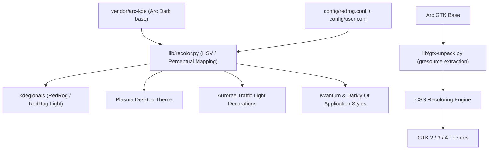
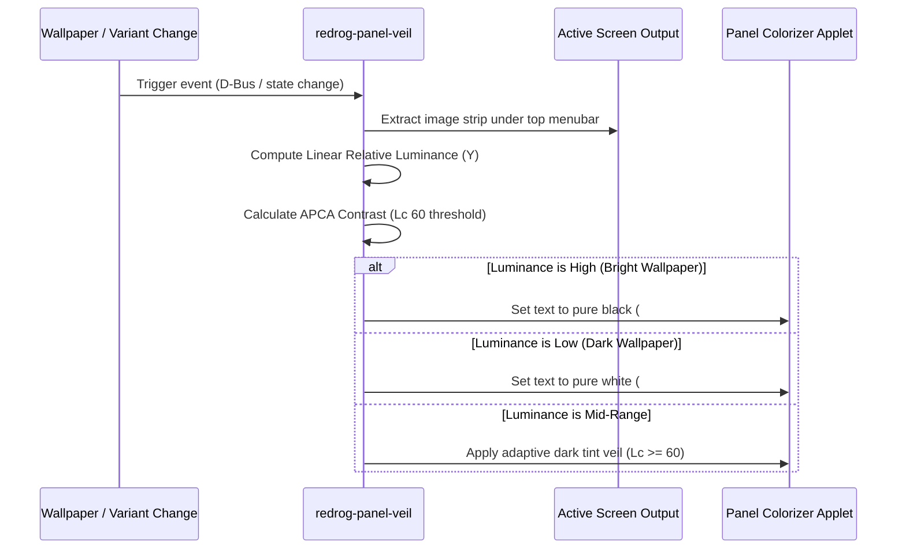
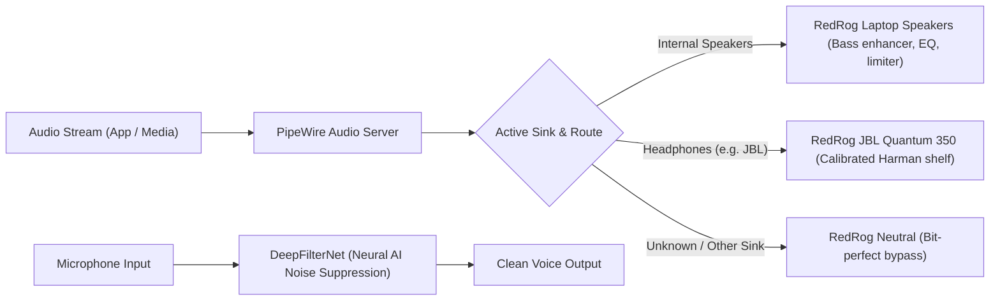

# System Architecture

This document provides a comprehensive technical overview of RedRog's internal architecture, execution lifecycle, styling pipelines, telemetry systems, and integration subsystems.

---

## 1. Directory Structure

```
├── bootstrap.sh                 # One-liner automated installation bootstrapper
├── install.sh                   # Main modular installer and orchestrator
├── uninstall.sh                 # Rollback and uninstallation entrypoint
├── config/                      # Configuration defaults and personal overrides
│   ├── redrog.conf              # Master defaults (palettes, fonts, icons, dock apps)
│   ├── user.conf.example        # Template for personal overrides (git-ignored)
│   └── audio/                   # Custom EasyEffects audio presets (speakers, headsets)
│       └── input/               # Custom microphone and noise suppression presets
├── lib/                         # Core utility libraries and transformation engines
│   ├── common.sh                # Path resolution, logging, gettext L(), kw/run wrappers
│   ├── palette.sh               # Color definition loader and variant variable resolver
│   ├── recolor.py               # Color mapping engine for Arc SVG, QML, and CSS assets
│   └── gtk-unpack.py            # GTK gresource decompiler and CSS extractor
├── modules/                     # Independent, self-contained installation modules
│   ├── colors/                  # Color scheme compilation (kdeglobals)
│   ├── plasma-style/            # Plasma theme, panel graphics, dialog translucency
│   ├── kvantum/                 # Kvantum and Darkly Qt application styles
│   ├── window-decoration/       # Aurorae decoration, macOS buttons, corner rounding
│   ├── gtk/                     # GTK 2, 3, 4 theme generation and Firefox integration
│   ├── appearance/              # Fonts, icons (Papirus), cursor, lock screen assets
│   ├── terminal/                # kitty configuration, custom tab bar, Qt context menu
│   ├── layout/                  # macOS panel layouts, dock, AppGrid, and plasmoids
│   ├── theme-switch/            # Live light/dark switcher and APCA panel veil daemon
│   ├── audio/                   # EasyEffects 8 DSP pipeline and device autoloaders
│   ├── artcraft/                # ArtCraft creative suite, local repo, MCP agent servers
│   ├── maintenance/             # Disk cleaner and system diagnostic utilities
│   ├── system/                  # Limine bootloader, SDDM greeter, network performance
│   └── ...                      # Application-specific integrations (obs, steam, etc.)
├── packages/                    # Dependency lists and local, patched PKGBUILDs
│   ├── pacman.txt               # Official repository dependencies
│   ├── aur.txt                  # Arch User Repository dependencies
│   ├── local.txt                # Locally built PKGBUILD manifests
│   └── <pkgname>/               # Individual PKGBUILD sources and patches
├── vendor/                      # Upstream Git subtrees and foundational assets
│   └── arc-kde/                 # Arc KDE base theme (colors, aurorae, plasma styles)
├── i18n/                        # Multi-language gettext translation catalogs (.pot / .po)
├── hosts/                       # Reference machine hardware tuning and snapshots
│   └── asus-tuf-f15/            # Asus TUF Gaming F15 FX507ZC4 hardware tuning
└── docs/                        # Technical documentation and research reports
    ├── INSTALL.md               # Complete installation and setup guide
    ├── ARCHITECTURE.md          # Technical architecture specification (this file)
    ├── CUSTOMIZE.md             # Customization, theming, and translation guide
    ├── MAINTENANCE.md           # System maintenance and package lifecycle manual
    ├── TROUBLESHOOTING.md       # Diagnostic procedures and issue resolution
    └── research/                # In-depth engineering research reports
        ├── asus-tuf-f15-thermals.md          # Thermal management and power profiles
        ├── futuristic-gamer-kde-dotfiles.md  # Design system and aesthetics analysis
        ├── macos-like-apps.md                # Application workflows and styling
        ├── jbl-bass-eq.md                    # Headphone EQ and acoustic calibration
        ├── macos-menubar-legibility.md       # Menubar contrast and APCA veil math
        └── installed-software.tsv            # System software inventory
```

---

## 2. Core Design Principles

### Copy-and-Generation Architecture
RedRog rejects fragile symlink structures that break when repositories are moved or re-cloned. All configuration files and graphical assets are generated or copied directly into standard XDG user directories (`$XDG_CONFIG_HOME`, `$XDG_DATA_HOME`, `$XDG_STATE_HOME`). The repository can reside in any arbitrary directory (`~/.dotfiles` is recommended).

### Deterministic Execution and Safe Dry-Run Engine
All filesystem modifications, KDE configuration writes (`kwriteconfig6`), and color transformations execute through wrappers defined in `lib/common.sh`:
- `run`: Runs a command, logging the action in standard output or suppressing execution when `DRY_RUN=1`.
- `kw`: Wraps `kwriteconfig6` to enforce consistent group, key, and value formatting across Plasma configuration files.
- `recolor`: Pipes templates through `lib/recolor.py` with parameter validation.

Passing `--dry-run` to `install.sh` evaluates the entire deployment pipeline and prints all commands without altering user files.

### Privilege Separation
`install.sh` runs as an unprivileged user. Any operations requiring administrative access (such as `pacman` installation or writing bootloader configurations to `/boot` and `/etc`) are isolated to dedicated stages (`--packages` and `--system`) that invoke `sudo` explicitly.

---

## 3. Theming Engine and Color Pipeline

RedRog synthesizes its visual presentation from the Arc KDE upstream project (`vendor/arc-kde`), transforming base assets through automated color mapping and surgical tweaks:



### Color Mapping Algorithm (`lib/recolor.py`)
Rather than doing crude string replacements, `lib/recolor.py` analyzes the color tokens in Arc Dark SVG assets, CSS files, and QML definitions. It computes perceptual lightness, hue, and saturation offsets relative to Arc's baseline blue-gray palette, projecting them onto RedRog's crimson and charcoal palette while preserving anti-aliasing gradients and optical contrast.

### Dual-Variant Architecture (Dark & Light)
Both variants are generated and installed simultaneously:
- **RedRog (Dark):** Built on deep neutral grays (`#1c1c1c` window backgrounds, `#252524` surfaces) with vivid crimson accents (`#ef3340`).
- **RedRog Light:** Built on calibrated warm whites and Pantone Cloud Dancer grays (`#f6f4f0` surfaces, `#ffffff` windows) with Pantone 1795 C accents (`#d62828`).

Because both themes are installed side-by-side, switching between Dark and Light mode via `redrog-theme-switch` occurs instantaneously without compiling assets at runtime.

---

## 4. Desktop Compositor and Window Decoration

### Window Decoration (`modules/window-decoration`)
- **macOS Traffic Light Controls:** Implemented via custom Aurorae window decorations (`modules/window-decoration/traffic-lights.py`), featuring clean red, yellow, and green circular controls with hover state glyphs (+, -, x).
- **GPU-Accelerated Rounded Corners:** Utilizes `kwin-effect-rounded-corners-git` to apply clean 10px corner rounding to client windows under KWin Wayland without clipping artifacts.

### Blur and Frosted Glass Pipeline
To achieve consistent frosted glass aesthetics across both Qt Widgets and QML applications:
1. **Dual-Cavity Blur (`kwin-effects-better-blur-dx`):** Replaces KWin's stock blur with an optimized shader that eliminates dark halos around translucent borders and handles high-radius gaussian blur efficiently.
2. **Selective Window Matching:** `modules/plasma-style` configures exact window class rules so System Settings, Discover, and ROG Control Center receive real-time frosted glass effects.
3. **Window Placement Management:** The `redrog-menu-placement` KWin script repositions popup menus directly adjacent to cursor coordinates, while `redrog-craft-fit` ensures large creative application windows are centered and restricted to 90% of screen dimensions.

---

## 5. Menubar Legibility and Dynamic Panel Veil

Achieving a true macOS-like transparent menubar over dynamic wallpapers presents a fundamental contrast problem: light text becomes unreadable over bright wallpapers, while dark text becomes unreadable over dark wallpapers.

RedRog implements an automated perceptual contrast engine via `redrog-panel-veil`:



For the underlying mathematical proofs and empirical testing on human readability, refer to [docs/research/macos-menubar-legibility.md](research/macos-menubar-legibility.md).

---

## 6. Plasmoids and Telemetry Subsystems

RedRog bundles custom QML plasmoids in `modules/layout`:

### `org.redrog.clock`
A minimalist, high-legibility single-line menu bar clock located in the top bar. Clicking the clock reveals an interactive calendar popup styled in RedRog glass with event integrations.

### `org.redrog.batterypercent` & Telemetry Dashboard
Clicking the battery indicator in the top menubar opens the RedRog telemetry dashboard:
- **Non-Polling Lazy Architecture:** Unlike standard desktop monitors that continuously wake the CPU, RedRog's sensor polling loop is completely deactivated while the panel is closed. Opening the panel initiates D-Bus subscriptions to `org.kde.ksysguard.sensors`.
- **Hybrid GPU Sleep Preservation:** The dashboard queries `nvidia-smi` **only** if the discrete NVIDIA GPU is already awake according to sysfs power states (`/sys/bus/pci/devices/.../power/runtime_status`). This guarantees that checking battery status never wakes the discrete GPU from low-power suspend.
- **P-Core and E-Core Differentiation:** `CpuEqualizer.qml` inspects `/sys/devices/cpu_core` and `/sys/devices/cpu_atom` to display separate, accurate utilization graphs for Intel Performance cores and Efficiency cores.
- **State Machine Debouncing:** Changes to power profiles (`asusctl profile set`), battery limits (`asusctl battery limit`), or GPU modes (`supergfxctl -m`) transition through an atomic asynchronous runner that maintains a visual busy state until hardware confirmation is read back from the system bus.

---

## 7. Terminal Architecture and AI Agent Integration

RedRog configures `kitty` as the central terminal emulator:

```
~/.config/kitty/
├── kitty.conf               # User configurations and personal overrides
├── redrog-theme.conf        # Auto-generated palette colors (Dark / Light)
└── redrog-keys.conf         # Standardized keybindings and shortcut mappings
```

### Custom macOS-Style Tab Bar (`tab_bar.py`)
`tab_bar.py` replaces kitty's default tab layout with a native macOS-inspired tab bar. Because kitty's native mouse handling only processes whole tab activations, RedRog implements a monkey-patched mouse event wrapper (`TabManager.handle_tab_bar_mouse`) that intercepts clicks on close buttons while passing through normal tab navigation events.

### Contextual Qt Menu (`redrog-kitty-menu`)
Right-clicking inside the terminal triggers a standalone QML contextual menu rendered via Qt's `qml` runtime:
- **IPC Mechanism:** Kitty triggers the helper script with remote control privileges (`kitten @ action --match id:<window>`).
- **Agent CLI Discovery:** The menu automatically detects available AI agent command-line tools in `$PATH` (Claude Code, Antigravity `agy`, OpenAI Codex, Gemini CLI, OpenCode, Aider) and allows instant launching in horizontal or vertical splits.

---

## 8. Audio DSP Pipeline (PipeWire & EasyEffects)

System-wide audio is managed through PipeWire and EasyEffects 8:



- **Route-Aware Autoloading:** EasyEffects 8 matches autoload profiles based on device names and localized route descriptions. Presets are deployed read-only to prevent accidental parameter corruption.
- **Persistent Preset Memory (`redrog-audio-memory`):** A lightweight background service monitors PipeWire device connection events, automatically restoring the last-used preset for each specific physical output or microphone.
- **Acoustic Research:** Speaker and headphone EQ curves are calibrated against measured acoustic impedance and frequency response targets. See [docs/research/jbl-bass-eq.md](research/jbl-bass-eq.md).

---

## 9. ASUS Hardware Daemon & Hybrid Graphics

On ASUS TUF and ROG platforms, RedRog interfaces with low-level platform features:

- **ASUS Notification Daemon (`redrog-rog-notify.py`):** Runs as a user systemd service, subscribing to `PropertiesChanged` signals from `asusd` over the system D-Bus. When hardware states change (fan profiles, charge limits, keyboard brightness), it triggers native desktop notifications translated into the user's desktop locale.
- **Hybrid Graphics Power Optimization:** On laptops featuring Intel/AMD integrated graphics alongside an NVIDIA discrete GPU, standard Wayland sessions often keep the dGPU awake due to Xwayland activity. RedRog deploys a custom `Xwayland` wrapper (`~/.local/bin/Xwayland`) that restricts Xwayland to the integrated GPU. The discrete GPU powers down to 0W until a dedicated 3D application or game requests PRIME offloading.
- **Thermal and Power Research:** For exhaustive benchmarks and power profile calibrations, refer to [docs/research/asus-tuf-f15-thermals.md](research/asus-tuf-f15-thermals.md) and [hosts/asus-tuf-f15/README.md](../hosts/asus-tuf-f15/README.md).

---

## 10. ArtCraft Suite and Agent Tooling Architecture

RedRog provides native infrastructure for the ArtCraft creative suite and companion creative tools (12 specialized Craft applications, SolidCraft 3D CAD, Altered Audio Editor, and BananaV video editor):

- **Local Package Repository:** Packages are hosted in `/var/lib/redrog-artcraft-repo` and managed by `redrog-artcraft-repo.service` and `redrog-artcraft-repo.timer`. Packages are cryptographically validated against `SHA256SUMS.txt` and GitHub releases before entering the repository database.
- **MCP Bridge (`artcraft-mcp`):** Registers each application as an MCP server with Claude Code and Antigravity. When an application's window is open, the MCP bridge communicates with its local control port (`127.0.0.1`) using a session token stored securely in `$XDG_RUNTIME_DIR`. When closed, the MCP bridge transparently executes the app's headless engine in a restricted directory sandbox.
- **Resource Slice Enforcement:** All Craft applications and their background MCP workers execute within `redrog-artcraft.slice`, enforcing systemd cgroup limits: max 75% CPU and 75–80% memory allocation. The companion service `redrog-craft-gpu.service` clamps GPU power targets during continuous generation tasks to prevent desktop stutter.

---

## 11. Cross-References and System Documentation

- **Setup and Deployment:** [docs/INSTALL.md](INSTALL.md)
- **User Customization Guide:** [docs/CUSTOMIZE.md](CUSTOMIZE.md)
- **System Maintenance Manual:** [docs/MAINTENANCE.md](MAINTENANCE.md)
- **Diagnostic Troubleshooting:** [docs/TROUBLESHOOTING.md](TROUBLESHOOTING.md)
- **Aesthetic and Dotfiles Research:** [docs/research/futuristic-gamer-kde-dotfiles.md](research/futuristic-gamer-kde-dotfiles.md)
- **macOS Application Ecosystem:** [docs/research/macos-like-apps.md](research/macos-like-apps.md)
- **Software Inventory:** [docs/research/installed-software.tsv](research/installed-software.tsv)
